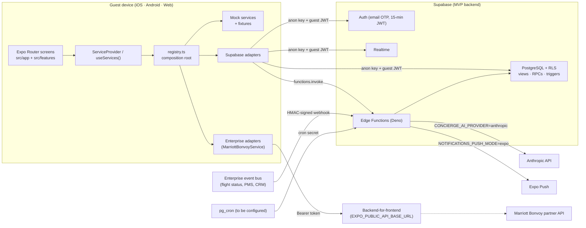

# 25 · Technical Architecture

This document gives the technical picture of the codebase in one place: the folder structure, frameworks, service layers, API integrations, data models and deployment configuration. It describes the code as it stands at commit `329aaeb`. The topic documents (01–24) go deeper; each section links to the one that covers it.

> **Two findings first** (details in [§7](#7-deployment-configuration)):
> 1. The committed web build in `dist/` **does not start**. It was exported with no `EXPO_PUBLIC_*` variables, so the release-build guard in `validateEnv()` stops it with "The app isn't quite ready".
> 2. There is **no Vercel configuration**. There is no `vercel.json`, so no SPA rewrite: a refresh or deep link on any route other than `/` returns 404.

---

## 1. System overview



The app is a single TypeScript codebase that runs on iOS, Android and the web. Screens never know where their data comes from. They call typed **service contracts**, and one composition root decides whether those contracts are met by in-memory mocks, by Supabase, or by enterprise adapters behind a backend-for-frontend (BFF).

## 2. Frameworks and tooling

| Concern | Choice | Notes |
|---|---|---|
| Runtime | **Expo SDK 57**, **React Native 0.86.3**, **React 19.2.3** | `package.json` |
| Web | `react-native-web` 0.21, Metro web bundler | `app.json → web.bundler: "metro"`, single-page output |
| Routing | **Expo Router 57** with typed routes | `experiments.typedRoutes`, deep-link scheme `rcycguest://` |
| Language | **TypeScript 6.0**, `strict`, `noUncheckedIndexedAccess` | Path alias `@/* → src/*` |
| Backend SDK | `@supabase/supabase-js` 2.117 | Lazily created; mock mode never loads a client |
| Secure storage | `expo-secure-store` (Keychain / Keystore) | Values over 2 KB are split into chunks (`security/chunkedStorage.ts`); on web it falls back to memory, never `localStorage` |
| Device storage | `@react-native-async-storage/async-storage` | Non-sensitive preferences only, under the `rcyc.` prefix |
| UI | `expo-image`, `expo-linear-gradient`, `@expo/vector-icons` (Ionicons), Cormorant Garamond + Inter | Fonts imported one weight at a time to keep the bundle small |
| Server | Supabase: Postgres + RLS, Auth, Realtime, Storage, **Edge Functions on Deno** | `supabase/` |
| AI | Anthropic Messages API, **server-side only** | `supabase/functions/_shared/concierge/providers/anthropic.ts` |
| Lint | ESLint 9 flat config + `eslint-config-expo` | Also enforces the layer boundaries (§4) |
| Checks | `tsx` scripts under `scripts/` | `npm run verify` = typecheck, lint and 22 check suites |

There is no Jest or React Testing Library. Behaviour is checked by the `scripts/check-*.ts` suites, which run headless in Node against the mock services and pure models, and by `npm run test:supabase` (§6.4).

## 3. Folder structure

```
RCYC-Loyalty-App/
├── app.json                 Expo config: name, scheme, bundle ids, plugins, typed routes
├── package.json             Dependencies and the verify / check:* / seed / test scripts
├── tsconfig.json            strict TS, @/* alias, excludes supabase/functions (Deno)
├── eslint.config.js         Expo rules + architecture boundary rules
├── .env.example             EXPO_PUBLIC_* only (never secrets)
├── assets/                  App icon, Android adaptive icons, splash, favicon
├── dist/                    Committed Expo web export (see §7; listed in .gitignore but force-added)
├── docs/                    Architecture docs 01–25, manual test checklist, screenshots
├── scripts/                 check-*.ts suites, generate-seed.ts, supabase/ integration runner
├── supabase/
│   ├── config.toml          Local project: auth policy, JWT expiry, function JWT settings
│   ├── migrations/          13 ordered SQL migrations (schema, RLS, RPCs, views, triggers)
│   ├── seed.sql             Generated from the TS fixtures (npm run seed:generate)
│   ├── tests/               SQL smoke tests: RLS, preferences, integration, index audit, scale probe
│   └── functions/           Edge Functions + _shared runtime-agnostic engines
└── src/
    ├── app/                 Expo Router: every file is a route (thin; renders a feature screen)
    │   ├── _layout.tsx      Root: fonts, SafeArea, ServiceProvider, JourneyProvider, ErrorBoundary
    │   ├── (tabs)/          Home (index), Voyage, Discover, Concierge, Profile
    │   └── …                arrival, celebration/[key], demo, history/*, notifications/*,
    │                        port/[id], recovery/[id], requests/*, welcome-home/*
    ├── features/<area>/     Screen + use<Area>() hook + <area>Model.ts (pure view-model) + components/
    ├── components/          Design-system primitives; no data access
    ├── hooks/               useJourney (session + journey phase), useAsync, useRefreshOnFocus, a11y hooks
    ├── theme/               Design tokens (colours, type, spacing)
    ├── domain/              Pure TypeScript domain types; no dependencies of any kind
    ├── services/
    │   ├── contracts/       The Services interface and every service contract + ServiceError
    │   ├── registry.ts      THE composition root: picks implementations by service mode
    │   ├── ServiceProvider.tsx  React context + useServices()
    │   ├── instrument.ts    Proxy that normalises errors to AppError and logs timing
    │   ├── mock/            Fixture-backed implementations, demo scripts, simulated crew
    │   ├── supabase/        Supabase implementations (one per bounded context) + row mappers
    │   ├── remote/          BFF ApiClient, MarriottBonvoyService, Supabase client, coalescingFetch
    │   ├── shared/          Logic shared by every mode (journey phase, recognition, calendar…)
    │   ├── <context>/       Composed services: occasions, notifications, recovery, postVoyage,
    │   │                    history, profile, continuity, events, analytics, push, personalization
    │   └── repositories/    KeyValueStore abstractions, preferences repository
    ├── security/            secureStorage, chunkedStorage, deviceData (wipe on sign-out), pii
    ├── core/                errors/ (AppError taxonomy, global handlers), logging/ (Logger, sinks)
    ├── config/env.ts        Typed EXPO_PUBLIC_* config + validateEnv() start-up guard
    ├── data/fixtures/       Fictional development dataset (mock mode only)
    └── utils/format.ts      Formatting helpers
```

How a feature is laid out: a route file under `src/app` renders `features/<area>/<Area>Screen.tsx`. The screen takes its data from a `use<Area>()` hook, which calls `useServices()`. The shaping for display lives in a pure `<area>Model.ts`, which the `check:<area>` script tests without React. More detail is in [docs/06](06-application-folder-structure.md).

## 4. Layers and boundaries

```
  Presentation     src/app · src/features · src/components · src/hooks
        │  useServices()  (only entry point)
  Contracts        src/services/contracts      ← interfaces + domain types only
        │
  Composition      src/services/registry.ts    ← the only place implementations are chosen
        │
  Implementations  mock/ · supabase/ · remote/ · composed services · shared/
        │
  Domain           src/domain                  ← pure types, imported by every layer
```

ESLint enforces these boundaries (`eslint.config.js`):

| Rule | Applies to | Forbids |
|---|---|---|
| Presentation boundary | `src/app`, `src/features`, `src/components`, `src/hooks` | Importing `services/mock`, `services/remote`, `services/supabase`, `@supabase/*`, `@/data`, `services/registry` |
| Production purity | `services/remote`, `services/supabase`, `services/shared`, `services/contracts`, `core`, `config` | Importing fixtures (`@/data`) or mocks |
| Pure domain | `src/domain` | Importing `react`, `react-native`, `expo*` or anything under `@/*` |

### 4.1 Composition root (`src/services/registry.ts`)

`createServices(mode)` runs once inside `ServiceProvider`:

1. **`validateEnv()`** checks the configuration. It stops start-up with a fatal `AppError` if:
   * `SECRET_IN_BUNDLE`: the "anon" key is really a service-role key or an `sb_secret_` key.
   * `UNSAFE_BUILD`: a release build is missing `EXPO_PUBLIC_APP_ENV` or `EXPO_PUBLIC_SERVICE_MODE`, production is not on Supabase, or staging is on enterprise.
   * A remote mode is missing its URL or key.
2. **`compose(mode)`** builds the `Services` object:
   * `mock`: fixtures, a pinned demo clock (11 May 2027, 09:00 Miami), simulated crew, the in-memory event bus with the delayed-flight handlers, and the executive demo script.
   * `supabase`: `createSupabaseServices()`, where every context is backed by Supabase and the real clock is used.
   * `enterprise`: the mock set with a real clock, plus enterprise adapters that are swapped in one bounded context at a time. Today only `loyalty` is swapped, for `MarriottBonvoyService`.
3. **Cross-cutting wrappers**, applied in order:
   * `wipingOnSignOut`: sign-out also wipes device data and the access token.
   * `withAnalytics`: privacy-safe product events, sent only with consent. Production uses a no-op provider until a vendor is chosen.
   * `instrumentServices`: a Proxy that turns every failure into an `AppError` and logs each call's duration, flagging calls over 1.5 s.

### 4.2 Service contracts (`src/services/contracts/index.ts`)

`Services` has 21 members:

| Group | Services |
|---|---|
| Identity and guest | `auth`, `profile`, `loyalty` |
| Voyage and booking | `voyage`, `experience`, `schedule` |
| Service | `concierge`, `requests`, `occasions`, `recovery`, `continuity` |
| Engagement | `personalization`, `notifications`, `push`, `postVoyage`, `history` |
| Platform | `journeyEvents`, `analytics`, `audit`, `clock`, `demo` |

There are also internal contracts that are not exposed to screens: `ConciergeAIProvider`, `EventService` and `EventHandler`, `TransferService`, `TravelDisruptionService`, `ServiceRecoveryOperations` and `AnalyticsProvider`. Errors cross the boundary as `ServiceError`, with codes `unauthenticated`, `forbidden`, `not_found`, `conflict`, `validation`, `unavailable` or `unknown`. More detail is in [docs/05](05-service-interfaces.md).

### 4.3 Composed services

Several services contain no data access of their own. They are built from the core services plus a small **store** port, so the same business logic runs in every mode:

| Service | Built from | Store port (mock / Supabase) |
|---|---|---|
| `ComposedOccasionService` | profile, loyalty, voyage, experience, requests | none |
| `ComposedNotificationService` | profile, voyage, experience, requests, journeyEvents, personalization | `MemoryNotificationState` / `SupabaseNotificationState` |
| `ComposedRecoveryService` | profile, loyalty, voyage, experience, requests | `MemoryRecoveryStore` / `SupabaseRecoveryNoticeStore` |
| `ComposedPostVoyageService` | profile, loyalty, voyage, experience, requests | `MemoryPostVoyageStore` / `SupabasePostVoyageStore` |
| `ComposedVoyageHistoryService` | voyage, profile | `MemoryVoyageHistoryStore` / `SupabaseVoyageHistoryStore` |
| `RepositoryGuestProfileService` | a guest-record source | `LocalPreferencesRepository` (device + memory) / `SupabasePreferencesRepository` |

### 4.4 Internal event model

`InMemoryEventService` (`services/events/`) is an in-process bus:

* It validates each event's envelope and drops repeats by `dedupe_key`.
* It runs the handlers for an event type in the order they were registered.
* Follow-up events carry a `correlation_id` and a `causation_id`, and chains stop at a depth of 4.

The `FLIGHT_DELAYED` chain registers five handlers, in this order: voyage, travel disruption, transfer, notification and concierge. In production the same contract is meant to sit over a durable queue and the `journey_events` table ([docs/16](16-internal-events.md)).

### 4.5 Cross-cutting concerns

| Concern | Where | Behaviour |
|---|---|---|
| Errors | `core/errors` | `AppError` taxonomy, `toAppError`, guest-safe messages, global handlers; root `ErrorBoundary` = `ErrorFallback` |
| Logging | `core/logging` | Scoped `Logger`; `ConsoleSink` in development, `MemorySink`; level from `EXPO_PUBLIC_LOG_LEVEL` (`warn` in production) |
| Session and journey | `hooks/useJourney.tsx` | Resolves the guest and the journey phase once (`dream → book → prepare → embark → sail → explore → return → remember → rebook`); shows sign-in when there is no session |
| Device data | `security/deviceData.ts` | Everything under `rcyc.` is wiped at sign-out; dietary and accessibility preferences are held in memory only |
| Request deduplication | `remote/coalescingFetch.ts` | Identical PostgREST reads in flight share one request (Home went from 111 requests to 47); a write clears what is in flight |
| Analytics | `services/analytics` | Schema-checked events; never PII, guest ids or concierge text; follows the consent preference ([docs/19](19-analytics.md)) |

## 5. API integrations

| Integration | Status | Client-side | Server-side | Credentials |
|---|---|---|---|---|
| **Supabase Auth** | Built | `SupabaseAuthService`: six-digit email OTP, no self-signup | `config.toml`: 15-min JWT, refresh rotation, TOTP MFA available | Anon key (public, protected by RLS) |
| **Supabase PostgREST** | Built | Supabase adapters: tables, `*_local` views, RPCs | RLS on every table; `private` schema for PII | Guest JWT |
| **Supabase Realtime** | Built | `.channel()` subscriptions in concierge, requests, recovery, continuity, journey events | Postgres changes | Guest JWT |
| **Edge Function `concierge-respond`** | Built | `SupabaseConciergeService` → `functions.invoke` | Validation, authorisation, rate limit (`concierge_take_slot`), idempotency, minimised context, model call, guards, escalation, audit in `concierge_ai_runs` | `CONCIERGE_AI_PROVIDER`, `ANTHROPIC_API_KEY`, optional `CONCIERGE_AI_MODEL` |
| **Anthropic API** | Built, off by default | none | `providers/anthropic.ts`; the default provider is `mock` | Function secret only |
| **Edge Function `personalization-next-best`** | Built | `SupabasePersonalizationService` | Deterministic rules engine; strips internal signals for guests | Guest JWT |
| **Edge Function `journey-events`** | Built (webhook) | none | Inbound from the enterprise bus: HMAC + 5-min replay window, idempotent insert, guest alerts, service recovery, continuity orchestrator | `JOURNEY_EVENTS_HMAC_SECRET`, `PSEUDONYM_SALT`; `verify_jwt = false` |
| **Edge Function `notifications-dispatch`** | Built (scheduled) | none | Sends due contextual notifications to registered devices; `dry-run` by default, `expo` to send | `NOTIFICATIONS_CRON_SECRET`, `NOTIFICATIONS_PUSH_MODE`, `EXPO_ACCESS_TOKEN` |
| **Edge Function `service-recovery-scan`** | Built (scheduled) | none | Finds unreported disruptions every 15 min | `RECOVERY_CRON_SECRET` |
| **Expo Push (device side)** | **Not built** | `UnsupportedPushRegistrar` on every platform | `push_devices`, `register_push_device` RPC are ready | needs `expo-notifications` ([docs/13](13-notifications.md)) |
| **pg_cron schedules** | **Not configured** | none | The functions expect to be called every 5 and 15 minutes; no migration creates the jobs | Cron secrets |
| **Backend-for-frontend** | Client only | `ApiClient`: Bearer token from secure storage, `X-Request-Id`, status → `ServiceError` | **Not in this repo** | `EXPO_PUBLIC_API_BASE_URL` |
| **Marriott Bonvoy** | Client only | `MarriottBonvoyService`: `GET /loyalty/{id}/membership \| relationship \| privileges \| recognition`, `POST /loyalty/{id}/link` | The code comment cites a `loyalty` Edge Function, but **none exists** in `supabase/functions` | OAuth client credentials (server-side, planned) |
| **Bonvoy sign-in** | Contract only | `auth.signInWithBonvoy()` | none | none |
| **Flight status, PMS, CRM** | Mocked | `MockTravelDisruptionService`, `MockTransferService` | Reach the app as `journey-events` once a bus exists | none |
| **Product analytics vendor** | Not chosen | `ConsoleAnalyticsProvider` (development) / `NoopAnalyticsProvider` (production) | none | none |

Read-only RPCs the app calls: `current_guest_id`, `my_personal_details`, `my_relationship`.
Write RPCs: `cancel_experience_booking`, `request_experience_booking_change`, `close_service_request`, `respond_to_recovery_notice`, `decide_goodwill_proposal`, `register_push_device`.

The enterprise target (reservations PMS, shipboard PMS, CRM and the AI platform, all reached through the BFF) is described in [docs/02](02-enterprise-integration-architecture.md).

## 6. Data models

### 6.1 Domain model (`src/domain`, pure TypeScript)

| Module | Key types |
|---|---|
| `common` | `ID`, `ISODateTime`, `ISODate`, `TimeZone`, `Money`, `GeoPoint`, `MediaAsset`, `SourceRef`, `RequestStatus` |
| `guest` | `Guest`, `GuestProfile`, `TravelCompanion`, `SpecialOccasion`, `GuestPreferences` (dining, dietary, beverage, suite, excursion, spa, transportation, accessibility, privacy, communication), `VersionedPreferences`, `PreferencesPatch` |
| `loyalty` | `BonvoyTier`, `LoyaltyMembership`, `GuestPrivilege`, `GuestRelationship`, `LoyaltyRecognition` |
| `voyage` | `Yacht`, `Suite`, `SuiteCategory`, `Voyage`, `PortCall`, `VoyageReservation`, `Embarkation`, `AmbassadorContact`, `LuggageArrangement`, `TravelDocument`, `FlightSegment`, `VoyageOverview`, `JourneyPhase` |
| `experience` | `Experience`, `ExperienceAvailability`, `ExperienceBooking`, `ScheduleItem`, `DaySchedule`, `DiscoverCollection`, `Destination`, `CalendarEntry`, `CalendarDay` |
| `concierge` | `ConciergeMessage`, `ConciergeIntent`, `ConciergeClassification`, `ConciergeAction`, `EscalationRequest`, `EscalationResult`, `GuestContext`, `ServiceRequest` |
| `requests` | `GuestServiceRequest`, `NewServiceRequest`, category, status, priority |
| `celebrations` | `DetectedCelebration`, `CelebrationProposal`, `CelebrationPlan`, `CelebrationApproval` |
| `events` | `JourneyEvent`, `JourneyEventType`, `EventSeverity`, `GuestNotification`, `JourneyAlert` |
| `internalEvents` | `InternalEvent`, `InternalEventType`, `InternalEventPayloads`, `HandlerRun` |
| `notifications` | `InboxNotification`, `UpcomingNotification`, `NotificationSettings`, `PushDevice`, `PushPermission` |
| `personalization` | `PersonalizationSignal`, `Recommendation`, `RecommendationSurface` |
| `recovery` | `RecoveryNotice`, `GuestRecoveryAlternative`, `RecoveryApproval`, `RecoveryRecord` |
| `continuity` | Arrival-context types for the delayed-flight story |
| `postVoyage` | `VoyageRecap`, `RecapDay`, `RecapMemory`, `VoyageFeedback`, `VoyageInspiration`, `CrewToThank` |
| `voyageHistory` | `PastVoyageRecord`, `VoyageHistoryEntry`, `PastVoyageMoment`, `SavedPreference` |
| `analytics` | `AnalyticsEventName`, `AnalyticsEventProps`, `AnalyticsEnvelope` |

More detail is in [docs/03](03-domain-model.md).

### 6.2 Database schema (`supabase/migrations`)

The schema is PostgreSQL with Row Level Security on every table. The `private` schema holds PII (`guest_pii`) and trigger functions. Helper functions in `public` (`current_guest_id`, `has_role`, `is_crew`, `on_reservation`, `crew_for_reservation`, `crew_for_guest`, `leads_reservation`) drive the policies, which are of five kinds: own, party (same reservation), lead guest, crew and admin.

| Migration | Adds |
|---|---|
| `…02_init` | Enums; `guests`, `private.guest_pii`, `user_roles`, `loyalty_memberships`, `guest_relationships`, `privileges`, `yachts`, `suites`, `voyages`, `port_calls`, `reservations`, `reservation_guests`, `embarkations`, `travel_documents`, `guest_preferences`, `travel_companions`, `special_occasions`, `experiences`, `experience_bookings`, `day_schedule_items`, `concierge_conversations` / `_messages`, `service_requests` / `_events`, `journey_events`, `journey_alerts`, `personalization_signals`, `recommendations`, `recommendation_feedback`, `audit_log` (immutable by trigger) |
| `…03_preferences_v2` | Preference guard + audit triggers, crew read policy |
| `…04_supabase_integration` | `guest_privileges`, `experience_slots`, `destinations`, `discover_collections`, `voyage_days`, `flight_segments`, `dining_bookings`, `spa_bookings`, `excursion_bookings`, `notifications`; views `excursions`, `voyage_guests`, and the time-zone-aware `*_local` views; booking RPCs; auth-user ↔ guest linking triggers; row-change audit triggers |
| `…05_concierge_links` | Party policy for linked concierge records |
| `…06_concierge_ai` | `concierge_ai_runs` (idempotency + audit for model calls) |
| `…07_guest_service_requests` | Request lifecycle trigger, `close_service_request` RPC |
| `…08_notifications` | `notification_receipts`, `push_devices`, `register_push_device` RPC |
| `…09_service_recovery` | `service_recovery_events`, `recovery_notices`, `goodwill_rules`, `goodwill_policy`, `goodwill_proposals`, response and decision RPCs |
| `…10_continuity` | `arrival_updates`, `continuity_tasks` |
| `…11_post_voyage` | `voyage_feedback`, `voyage_inspirations` |
| `…12_voyage_history` | `voyage_history` |
| `…13_performance` | Indexes from the performance audit |
| `…14_security` | Tightened policies, `concierge_rate_limits`, `concierge_take_slot` |

More detail is in [docs/04](04-database-schema.md).

### 6.3 Mapping and fixtures

* `services/supabase/rows.ts` maps database rows to domain types, so screens only ever see domain types.
* `src/data/fixtures/` is the fictional dataset (Alexander and Camille Laurent, *Evrima*, Grand Suite 612, 15–22 May 2027). `scripts/generate-seed.ts` writes the same dataset to `supabase/seed.sql`, so mock mode and Supabase mode show the same story.

### 6.4 Testing the data layer

* `npm run check:supabase` needs no infrastructure and runs inside `verify`.
* `npm run test:supabase` creates a throwaway PostgreSQL cluster and PostgREST. It applies the stubs, the migrations, the seed and the SQL tests in `supabase/tests`, then runs the app's Supabase services against them.

## 7. Deployment configuration

### 7.1 Environment variables (bundled; `EXPO_PUBLIC_*` only)

| Variable | Values | Default when unset |
|---|---|---|
| `EXPO_PUBLIC_APP_ENV` | `development` · `staging` · `production` | `development`, but **a release build will not start without it** |
| `EXPO_PUBLIC_SERVICE_MODE` | `mock` · `supabase` · `enterprise` | `mock`, but **a release build will not start without it** |
| `EXPO_PUBLIC_SUPABASE_URL` / `_ANON_KEY` | https URL / anon key | required in `supabase` mode |
| `EXPO_PUBLIC_API_BASE_URL` | https URL of the BFF | required in `enterprise` mode |
| `EXPO_PUBLIC_LOG_LEVEL` | `debug` · `info` · `warn` · `error` | `debug` (`warn` in production) |
| `EXPO_PUBLIC_DEMO_NOW` | ISO date-time | dataset reference moment (mock mode only) |
| `EXPO_PUBLIC_MOCK_SCENARIO` | `default` · `empty` · `slow` · `error` · `partial-error` | `default` |
| `EXPO_PUBLIC_DEMO_MODE` | `off` · `executive` | `off` (mock mode only) |

Allowed combinations:

* `production` runs on `supabase` only.
* `staging` runs on `mock` or `supabase`.
* `enterprise` is for development only, because it has no real sign-in yet.

Expo inlines these values when the bundle is built, so changing one means rebuilding.

### 7.2 Server secrets (Supabase Edge Function secrets; never in the app)

| Area | Secrets |
|---|---|
| Concierge | `CONCIERGE_AI_PROVIDER`, `ANTHROPIC_API_KEY`, `CONCIERGE_AI_MODEL` |
| Journey events | `JOURNEY_EVENTS_HMAC_SECRET`, `PSEUDONYM_SALT` |
| Notifications | `NOTIFICATIONS_CRON_SECRET`, `NOTIFICATIONS_PUSH_MODE`, `EXPO_ACCESS_TOKEN` |
| Recovery scan | `RECOVERY_CRON_SECRET` |

### 7.3 Supabase project (`supabase/config.toml`)

* **API:** schema `public`, `max_rows = 200`.
* **Auth:**
  * No sign-up and no anonymous sign-in. Guests are invited from reservations.
  * Six-digit email OTP that expires after 10 minutes; at most one code per address per minute.
  * 15-minute JWTs with refresh-token rotation; TOTP MFA is enabled.
  * Redirects go to `rcycguest://auth/callback`.
* **Functions:** `journey-events`, `notifications-dispatch` and `service-recovery-scan` set `verify_jwt = false` and check their own HMAC or cron secret. The other functions require the guest's JWT.
* **Storage:** 10 MiB file limit.

Deploying the backend uses the Supabase CLI: `supabase db push`, `supabase functions deploy`, `supabase secrets set …`. Repository changes still needed:

* a pg_cron migration that schedules the two scheduled functions;
* production SMTP, because the local email limit is 2 per hour.

### 7.4 Native builds

`app.json` sets:

* Bundle id / package `com.example.rcyc.guest` (a placeholder).
* Portrait, light mode, iPad supported, `usesNonExemptEncryption: false`.
* Plugins: `expo-router`, `expo-secure-store`, `expo-font`, `expo-splash-screen`.

There is **no `eas.json`**, so EAS Build profiles, signing and per-profile environment variables still need to be defined. `ios/` and `android/` are git-ignored, so native projects are generated with prebuild.

### 7.5 Web build and Vercel: current state

The last commit (`329aaeb`, "Add Expo web build for Vercel deployment") committed `dist/`. That folder is the output of `npx expo export --platform web`: a single `index.html`, one 1,240-line entry bundle, fonts and assets, 5.4 MB in total. `dist/` is listed in `.gitignore` but its 29 files were force-added.

I served `dist/` locally and loaded it in Chromium on 21 Nov 2026:

| Check | Result |
|---|---|
| `GET /` | Renders the error fallback: **"The app isn't quite ready"** |
| Console | `UNSAFE_BUILD: a release build needs EXPO_PUBLIC_APP_ENV…` and `…EXPO_PUBLIC_SERVICE_MODE…`, then `AppError: This build is not configured for its environment` |
| Inlined env in bundle | `{appEnv:void 0, serviceMode:void 0, supabaseUrl:void 0, …}`: every variable was empty at export time |
| `GET /voyage` | 404 from a static server. The export is a single-page app, and without a rewrite to `/index.html` every deep link or refresh away from `/` fails |

This is the start-up guard working as designed (docs/22): a release build that would quietly fall back to demo sign-in must not start. The deployment is what is incomplete. To publish a working web demo:

1. Build with the variables set, for example for a mock-data demo:
   `EXPO_PUBLIC_APP_ENV=staging EXPO_PUBLIC_SERVICE_MODE=mock npx expo export --platform web`
   (For a Supabase-backed staging site, use `EXPO_PUBLIC_SERVICE_MODE=supabase` with the URL and anon key.)
2. Prefer letting Vercel build: install command `npm ci`, build command `npx expo export --platform web`, output directory `dist`, with the `EXPO_PUBLIC_*` variables set in the Vercel project. Then stop committing `dist/`.
3. Add a `vercel.json` SPA rewrite:
   ```json
   { "rewrites": [{ "source": "/(.*)", "destination": "/index.html" }] }
   ```
   Alternatively, set `"web": { "output": "static" }` in `app.json`, which pre-renders a page per route.
4. Know the web limits: secure storage falls back to memory, so a refresh signs the guest out, and there is no push on web.

### 7.6 CI

There is **no CI workflow** in the repo (no `.github/workflows`). The natural gate is `npm ci && npm run verify`, optionally followed by `npm run test:supabase` on a runner with PostgreSQL and PostgREST, and then the web export.

## 8. Gaps at a glance

| # | Gap | Where | Impact |
|---|---|---|---|
| 1 | Web build exported without env vars | `dist/` | Deployed site shows only the error screen |
| 2 | No SPA rewrite / `vercel.json` | repo root | Deep links and refreshes 404 |
| 3 | `dist/` committed despite `.gitignore` | `dist/` | Stale builds drift from source |
| 4 | No CI | `.github/` | `verify` is not enforced on push |
| 5 | No `eas.json`; placeholder bundle id | `app.json` | Native builds not yet reproducible |
| 6 | `loyalty` Edge Function / BFF missing | `supabase/functions` | `enterprise` mode's Bonvoy adapter has no server |
| 7 | Bonvoy sign-in not built | `auth.signInWithBonvoy` | Production sign-in is email OTP only |
| 8 | Device push not built | `services/push` | Server dispatch has no device tokens |
| 9 | pg_cron jobs not defined | `supabase/migrations` | Notification and recovery scans never run |
| 10 | Analytics vendor not chosen | `services/analytics` | Production sends no product analytics |
